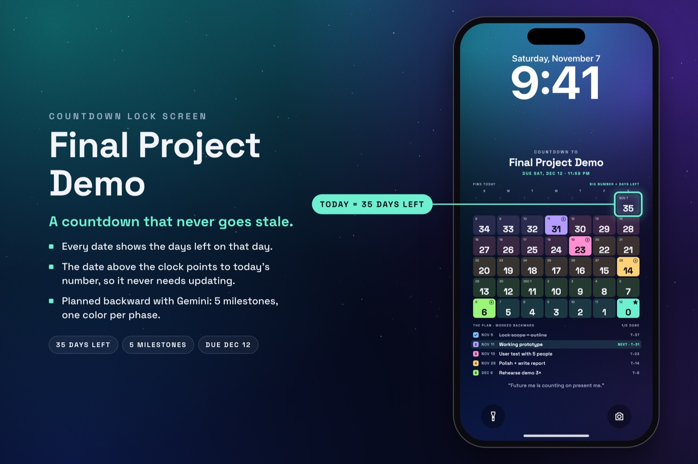
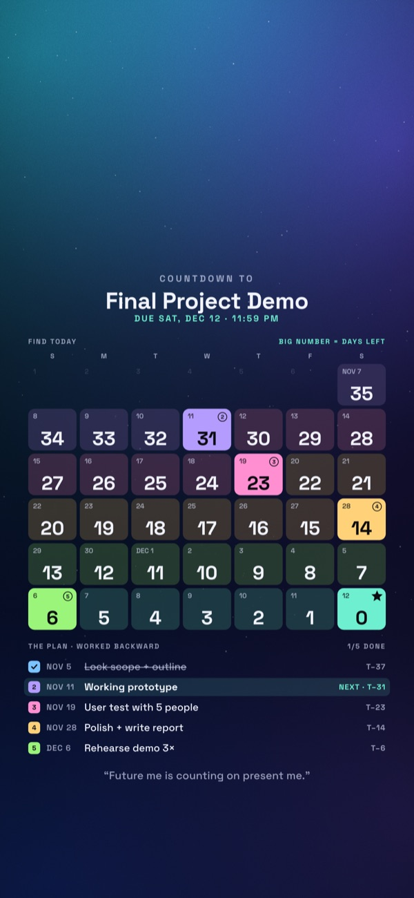
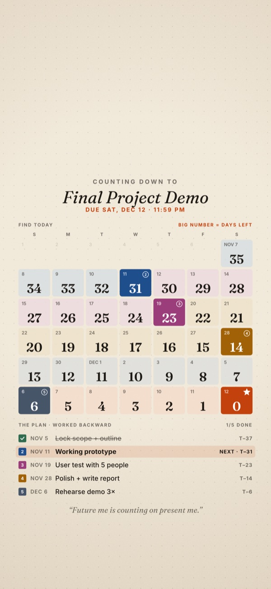
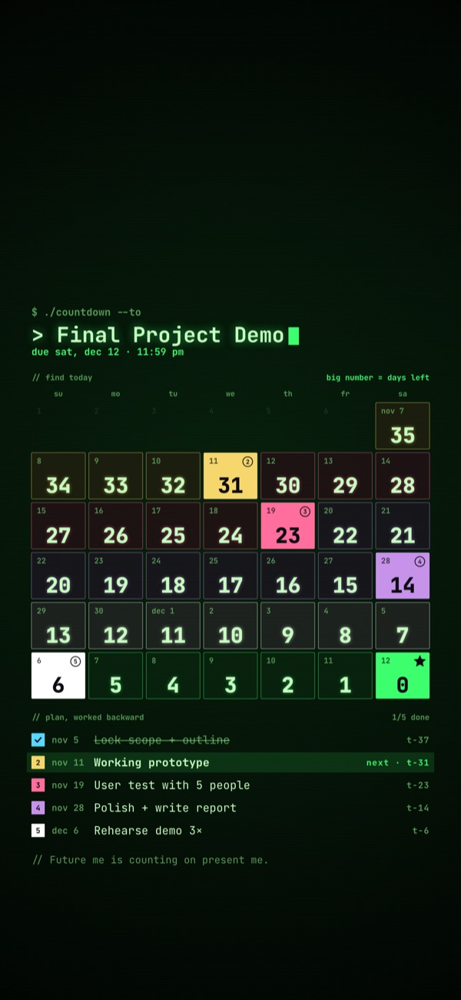
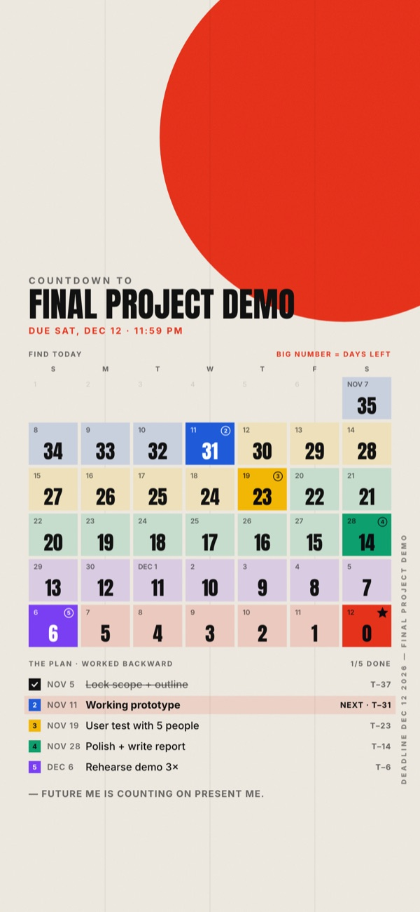
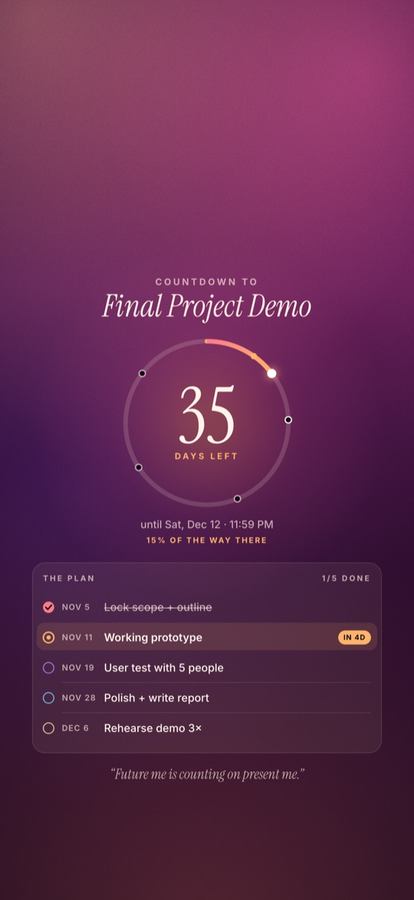

# ToothOps Countdown

**A countdown lock screen that never goes out of date.**

**Live app:** https://kristenseog.github.io/toothops-countdown/

Most countdown wallpapers say "35 days left" and are wrong the next morning. ToothOps Countdown uses a **T-minus calendar** instead: every date shows how many days will be left on that day. Your phone already shows today's date above the clock, so you find that date and read your number. The wallpaper stays correct until the deadline without ever being updated.

| Aurora | Paper | Terminal | Poster | Big countdown |
|---|---|---|---|---|
|  |  |  |  |  |

## What it does

- **Plan worked backward.** Enter the deadline and 3–6 milestones. Each stretch between milestones gets its own color, milestone days are solid, and the deadline is the star. The list underneath shows each milestone with its T-minus number.
- **Fits real screens.** Sizes for iPhone 12–17, Android and desktop. The top 30% stays clear for the clock and widgets, and the bottom stays clear for the flashlight and camera buttons. The preview draws the clock on top so you can check.
- **Five styles:** Aurora, Dusk, Paper, Poster and Terminal. There's also a big-number layout, and you can use your own background image.
- **Reminders.** A downloadable `.ics` calendar file with a daily nudge, an alert the day before each milestone, and deadline alerts.
- **Gemini prompt kit.** Prompts to plan backward, design a background and set reminders.
- **Pre-flight check** for readability: short milestones in order, a buffer before the deadline, and a personal "why".
- **Submission panel** for the Handshake challenge: title, the lock screen PNG, a 3:2 cover at 2400×1600, and a description that stays under 500 characters.

Everything runs in the browser in one file (`index.html`). Nothing is uploaded; your plan is saved only in your browser.

## Use it

1. Open the live app, or open `index.html` locally.
2. Plan with Gemini using prompt 1 from the prompt kit, then paste in your milestones.
3. Pick a style and download the lock screen PNG.
4. On iPhone: Settings → Wallpaper → Add New → Photos. Turn off Perspective Zoom.
5. Download the reminders file and open it to add the alerts to your calendar.
